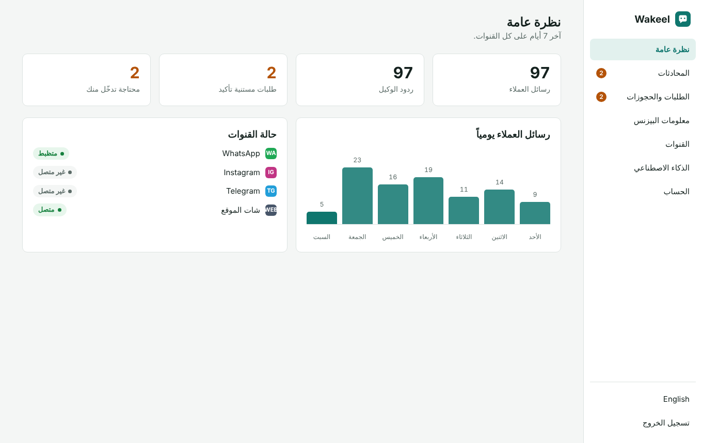

<div align="center">

# Wakeel · وكيل

**An open-source AI employee for small businesses.**
It answers your customers on WhatsApp, Instagram, Telegram and your website, 24/7, in their own dialect. It takes orders and bookings and hands the chat to you when a human is needed.

[](https://www.hostinger.com/docker-hosting?compose_url=https://raw.githubusercontent.com/mashraf1997/wakeel/main/docker-compose.yml&REFERRALCODE=YOUR_REFERRAL_CODE)

[English](#what-it-does) · [العربية](#بالعربي)


</div>

---

## What it does

- **One inbox for every channel.** WhatsApp (official Cloud API), Instagram DMs, Telegram and a chat bubble for your website.
- **Answers from your real information.** Add your menu, prices, opening hours and policies, or upload text files. The assistant answers only from that and never invents prices or promises.
- **Takes orders and bookings.** It collects the details, confirms them with the customer and logs a request with a short reference such as `R7KQ2`. You confirm with one click, and the customer gets a message in the same channel.
- **Knows when to step back.** If the customer asks for a person, gets upset, or asks something the assistant can't answer, it hands the chat to you. You can take over any chat at any time.
- **Speaks like your customers.** Replies in Egyptian, Gulf or Levantine Arabic, or in English, matching the customer. The dashboard is in Arabic and English.
- **Your model, your choice.** Use Claude from Anthropic, or run a free open model with Ollama on your own VPS. Any OpenAI-compatible API also works (OpenRouter, Groq, DeepSeek, and others).
- **Lightweight.** Node.js with a single dependency and no database server. Data lives in one JSON file you can back up.

<p align="center">
  
  
</p>

## Deploy

### One click on Hostinger

Click **Deploy on Hostinger** above. Hostinger sets up a VPS with Docker and starts Wakeel. Open `http://YOUR-SERVER-IP` and create your password. That's it.

### Docker (any VPS)

```bash
git clone https://github.com/mashraf1997/wakeel.git && cd wakeel
cp .env.example .env        # optional: set SETUP_TOKEN and ANTHROPIC_API_KEY
docker compose up -d        # http://YOUR-SERVER-IP
```

To run a private local model next to it:

```bash
docker compose --profile local-ai up -d
docker compose exec ollama ollama pull qwen3:8b
```

Then in **AI model**, choose *OpenAI-compatible*, set Base URL to `http://ollama:11434/v1` and model to `qwen3:8b`.

### Node.js

```bash
npm install
npm start          # http://localhost:3000
```

Requires Node.js 20 or newer. Works on any Node.js hosting, including shared web app plans.

To build the Docker image yourself instead of pulling it: `docker build -t ghcr.io/mashraf1997/wakeel:latest .`

## Connect your channels

| Channel | What you need | Time |
|---|---|---|
| Website | Paste `<script src="https://your-wakeel-domain/widget.js" async></script>` before `</body>` | 1 min |
| Telegram | A bot token from [@BotFather](https://t.me/BotFather) | 2 min |
| WhatsApp | A Meta developer app with the WhatsApp product: phone number ID, access token, and the webhook URL shown in the dashboard | 15 min |
| Instagram | An Instagram business account linked to a Facebook Page, a Page access token, and the same webhook URL | 15 min |

The dashboard walks you through every step. WhatsApp and Instagram need a public **HTTPS** URL for the webhook (`https://your-domain/webhooks/meta`). On a VPS, point a domain at it and enable SSL first.

## Configuration

Everything can be set from the dashboard. These environment variables are optional:

| Variable | Default | Purpose |
|---|---|---|
| `PORT` | `3000` | HTTP port |
| `DATA_DIR` | `./data` | Where `wakeel.json` is stored. Back this up. |
| `SETUP_TOKEN` | *(empty)* | When set, it is required to create the first admin. Recommended on public servers. |
| `ANTHROPIC_API_KEY` | *(empty)* | Claude key, used when none is entered in the dashboard |
| `AI_PROVIDER`, `AI_MODEL`, `AI_BASE_URL`, `AI_API_KEY` | | First-boot AI defaults, for example to point at Ollama |
| `META_GRAPH_VERSION` | `v23.0` | Graph API version for WhatsApp and Instagram |

## AI models

| Option | Notes |
|---|---|
| **Claude Opus 5.5** (default) | Best quality. Thinking effort defaults to *low*, which is enough for chat. |
| Claude Sonnet 5.5 / Haiku 5.5 | Faster and cheaper. Haiku 5.5 is the lowest-cost option. |
| Ollama (local) | Free and private. Needs a VPS with enough RAM for the model. |
| Any OpenAI-compatible API | OpenRouter, Groq, DeepSeek, Together, and others |

With Claude, Wakeel caches your business information between messages (prompt caching) to keep costs down. It also enables Anthropic's automatic fallback, so a declined request is retried on another model instead of failing.

## Security

- Your dashboard password is hashed with scrypt, and sessions use signed, HttpOnly cookies.
- Set `SETUP_TOKEN` so nobody else can claim a fresh install before you do.
- Meta webhooks are checked with `X-Hub-Signature-256` when you enter your App secret.
- Secrets are never sent back to the browser in full.
- The public widget API is rate-limited per IP.
- Run Wakeel behind HTTPS.

## Development

```bash
npm install
npm run dev     # restarts on file changes
npm test        # runs against fake Claude, OpenAI and Meta servers, no keys needed
```

```
server.js            entry point
src/app.js           HTTP routes (dashboard API, widget API, Meta webhook)
src/agent.js         prompt, tools (create_order, book_appointment, handoff_to_human)
src/ai.js            Claude via the Anthropic SDK, plus OpenAI-compatible providers
src/knowledge.js     Arabic-aware BM25 search over your documents
src/channels/        Telegram (long polling), WhatsApp and Instagram (Meta webhook)
public/              dashboard (no build step) and widget.js
```

## Roadmap

- [ ] Voice notes (speech to text)
- [ ] Images in chats (menus, product photos)
- [ ] Facebook Messenger
- [ ] Google Calendar availability for bookings
- [ ] WooCommerce and Shopify product sync
- [ ] Team members with separate logins
- [ ] Daily summary to the owner on WhatsApp

Pull requests are welcome. Please open an issue first for larger changes.

## License

MIT

---

<div dir="rtl">

## بالعربي

**وكيل** موظف ذكاء اصطناعي مفتوح المصدر لأي بيزنس صغير. بيرد على عملاءك على **واتساب وإنستجرام وتليجرام وموقعك** 24 ساعة، بنفس لهجتهم. بياخد الطلبات والحجوزات، ولو العميل محتاج حد من الفريق بيحوّلك المحادثة.

### بيعمل إيه؟

- **صندوق رسائل واحد لكل القنوات:** واتساب الرسمي، ورسائل إنستجرام، وتليجرام، وشات على موقعك.
- **بيرد من معلوماتك إنت بس:** المنيو والأسعار والمواعيد والسياسات، ومش هيألف سعر أو وعد.
- **بياخد طلبات وحجوزات:** بيأكد التفاصيل مع العميل ويديله رقم طلب. إنت تأكد بضغطة واحدة، والعميل يوصله إشعار على نفس القناة.
- **بيعرف إمتى يسيبك ترد:** لو العميل طلب حد من الفريق، أو اتضايق، أو سأل حاجة مش موجودة في معلوماتك.
- **بيتكلم زي عملاءك:** مصري، خليجي، شامي، أو إنجليزي.
- **إنت اللي بتختار النموذج:** Claude من Anthropic، أو نموذج مجاني على الـ VPS بتاعك عن طريق Ollama.

### التشغيل

1. اضغط **Deploy to Hostinger**.
2. افتح رابط التطبيق واعمل كلمة سر.
3. من **الذكاء الاصطناعي** حط مفتاح Claude أو اختار Ollama.
4. من **معلومات البيزنس** اكتب المنيو والأسعار.
5. من **القنوات** وصّل تليجرام في دقيقتين، أو واتساب وإنستجرام، أو انسخ سطر الشات وحطه في موقعك.
6. جرّب الوكيل من صفحة **الذكاء الاصطناعي** قبل ما تفتحه للعملاء.

</div>
