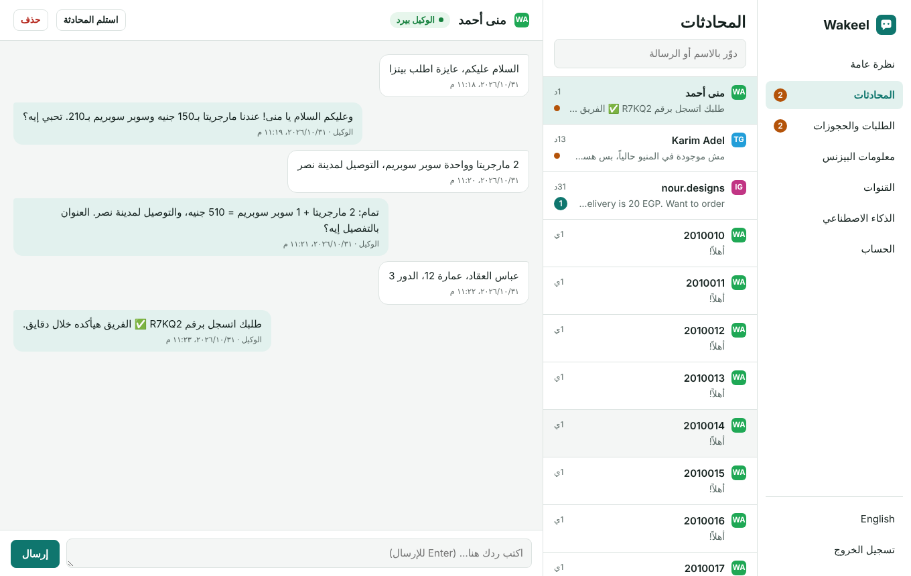
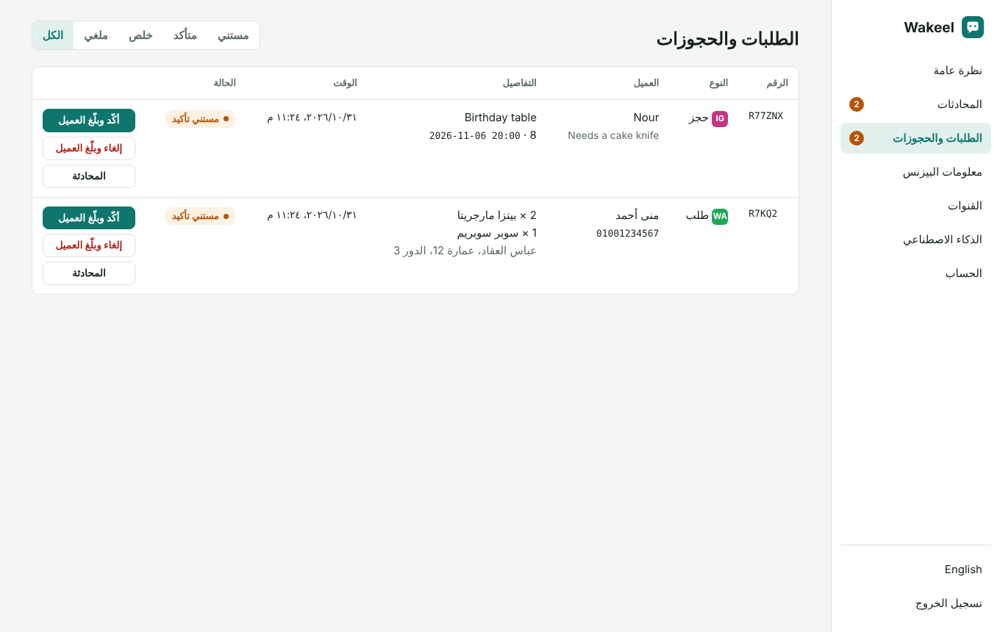

<div align="center">

# Wakeel · وكيل

**An open-source AI employee for small businesses.**
It answers your customers on WhatsApp, Instagram, Messenger, Telegram and your website, 24/7, in their own dialect. It understands voice notes and photos, takes orders and bookings, and hands the chat to you when a human is needed.

[](https://www.hostinger.com/docker-hosting?compose_url=https://raw.githubusercontent.com/mashraf1997/wakeel/main/docker-compose.yml&REFERRALCODE=YOUR_REFERRAL_CODE)

[English](#what-it-does) · [العربية](#بالعربي)


</div>

---

## What it does

- **One inbox for every channel.** WhatsApp (official Cloud API), Instagram DMs, Facebook Messenger, Telegram and a chat bubble for your website.
- **Ready in a minute.** Pick your business type (restaurant, clinic, salon, online store) and Wakeel fills in a sample menu, prices and policies you can edit. The assistant can answer from the first minute.
- **Answers from your real information.** Add your menu, prices, opening hours and policies, upload text files, or sync products from **Dukkan, WooCommerce or Shopify**. The assistant answers only from that and never invents prices or promises.
- **Understands voice notes and photos.** Voice notes are transcribed and answered. Customers can send a photo of the product they want, and the assistant looks at it.
- **Sends your menu.** Upload images like your menu or price list. When a customer asks, the assistant sends them.
- **Takes orders and bookings.** It collects the details, confirms them with the customer and logs a request with a short reference such as `R7KQ2`. You confirm with one click, and the customer gets a message in the same channel. With Dukkan, orders go straight into your store with the real order number and total.
- **Never double-books.** Set working hours and slot length, and optionally connect your Google Calendar's secret iCal address. The assistant offers only free times.
- **Tells you right away.** New orders, bookings and customers who need you trigger alerts on Telegram, in the browser, or to any webhook (n8n, Make, Zapier).
- **Knows when to step back.** If the customer asks for a person, gets upset, or asks something the assistant can't answer, it hands the chat to you. You can take over any chat at any time.
- **Speaks like your customers.** Replies in Egyptian, Gulf or Levantine Arabic, or in English, matching the customer. The dashboard is in Arabic and English.
- **Your model, your choice.** Use Claude from Anthropic, or run a free open model with Ollama on your own VPS. Any OpenAI-compatible API also works (OpenRouter, Groq, DeepSeek, and others).
- **Built for agencies too.** One server can run many businesses, each with its own dashboard, channels and data. Manage them all from the agency console.
- **Lightweight.** Node.js with a single dependency and no database server. Data lives in one JSON file you can back up.

<p align="center">
  
  
</p>

## Deploy

### One click on Hostinger

Click **Deploy on Hostinger** above. Hostinger sets up a VPS with Docker and starts Wakeel. Open `http://YOUR-SERVER-IP` and create your password. That's it.

### Docker (any VPS)

```bash
git clone https://github.com/mashraf1997/wakeel.git && cd wakeel
cp .env.example .env        # optional: set SETUP_TOKEN and ANTHROPIC_API_KEY
docker compose up -d        # http://YOUR-SERVER-IP
```

To run a private local model next to it:

```bash
docker compose --profile local-ai up -d
docker compose exec ollama ollama pull qwen3:8b
```

Then in **AI model**, choose *OpenAI-compatible*, set Base URL to `http://ollama:11434/v1` and model to `qwen3:8b`.

### Node.js

```bash
npm install
npm start          # http://localhost:3000
```

Requires Node.js 20 or newer. Works on any Node.js hosting, including shared web app plans.

To build the Docker image yourself instead of pulling it: `docker build -t ghcr.io/mashraf1997/wakeel:latest .`

## Connect your channels

| Channel | What you need | Time |
|---|---|---|
| Website | Paste `<script src="https://your-wakeel-domain/widget.js" async></script>` before `</body>` | 1 min |
| Telegram | A bot token from [@BotFather](https://t.me/BotFather) | 2 min |
| WhatsApp | A Meta developer app with the WhatsApp product: phone number ID, access token, and the webhook URL shown in the dashboard | 15 min |
| Instagram | An Instagram business account linked to a Facebook Page, a Page access token, and the same webhook URL | 15 min |
| Messenger | Your Facebook Page's access token and the same webhook URL | 10 min |

The dashboard walks you through every step. WhatsApp, Instagram and Messenger need a public **HTTPS** URL for the webhook (`https://your-domain/webhooks/meta`). On a VPS, point a domain at it and enable SSL first.

## More features

### Voice notes

Voice notes are transcribed with any OpenAI-compatible speech-to-text API. [Groq](https://console.groq.com) has a free tier: in **AI model → Voice notes**, set Base URL `https://api.groq.com/openai/v1`, model `whisper-large-v3-turbo` and your Groq key. Without it, the assistant politely asks the customer to type.

### Product sync

In **Business info → Sync products from your store**, pick the source and paste your store's address:

| Source | What Wakeel reads | Orders |
|---|---|---|
| [Dukkan](https://github.com/mashraf1997/dukkan) | Products, sizes, prices, stock, delivery fee and order types | Placed in Dukkan with its order number and total |
| WooCommerce | Products, prices and stock from the public Store API | Logged in Wakeel |
| Shopify | Products, variants and availability from `/products.json` | Logged in Wakeel |

No API keys are needed. Wakeel syncs every hour and whenever you press **Sync now**.

### Appointments

In **Business info → Appointments**, set opening hours, closed days and slot length. To block times you are busy, paste your Google Calendar's *Secret address in iCal format*. Outlook and Apple calendars work too. The assistant checks free times before it offers or books one.

### Notifications

In **Channels → Notifications**:
- **Telegram:** connect a bot, open the link shown and tap *Start*. Each new order, booking or handoff arrives on your phone.
- **Browser:** keep the dashboard open in a tab and allow notifications to hear a sound and see an alert.
- **Webhook:** every event is POSTed as JSON to your URL, ready for n8n, Make or Zapier. You can forward it to WhatsApp, email or Google Sheets from there.

### Agency mode

Set `AGENCY_PASSWORD` and open `/agency`. Add a business, choose its type and optionally set the owner's password. It gets its own dashboard at `/b/<name>/`, its own channels, widget (`/b/<name>/widget.js`) and webhook (`/b/<name>/webhooks/meta`), and its data lives in a separate folder. Signing in to the agency console also opens every business's dashboard.

## Configuration

Everything can be set from the dashboard. These environment variables are optional:

| Variable | Default | Purpose |
|---|---|---|
| `PORT` | `3000` | HTTP port |
| `DATA_DIR` | `./data` | Where `wakeel.json` is stored. Back this up. |
| `SETUP_TOKEN` | *(empty)* | When set, it is required to create the first admin. Recommended on public servers. |
| `ANTHROPIC_API_KEY` | *(empty)* | Claude key, used when none is entered in the dashboard |
| `AI_PROVIDER`, `AI_MODEL`, `AI_BASE_URL`, `AI_API_KEY` | | First-boot AI defaults, for example to point at Ollama |
| `AGENCY_PASSWORD` | *(empty)* | Turns on the agency console at `/agency` |
| `TRANSCRIBE_BASE_URL`, `TRANSCRIBE_MODEL`, `TRANSCRIBE_API_KEY` | | First-boot speech-to-text defaults for voice notes |
| `META_GRAPH_VERSION` | `v23.0` | Graph API version for WhatsApp, Instagram and Messenger |

## AI models

| Option | Notes |
|---|---|
| **Claude Opus 5.5** (default) | Best quality. Thinking effort defaults to *low*, which is enough for chat. |
| Claude Sonnet 5.5 / Haiku 5.5 | Faster and cheaper. Haiku 5.5 is the lowest-cost option. |
| Ollama (local) | Free and private. Needs a VPS with enough RAM for the model. |
| Any OpenAI-compatible API | OpenRouter, Groq, DeepSeek, Together, and others |

With Claude, Wakeel caches your business information between messages (prompt caching) to keep costs down. It also enables Anthropic's automatic fallback, so a declined request is retried on another model instead of failing.

## Security

- Your dashboard password is hashed with scrypt, and sessions use signed, HttpOnly cookies.
- Set `SETUP_TOKEN` so nobody else can claim a fresh install before you do.
- Meta webhooks are checked with `X-Hub-Signature-256` when you enter your App secret.
- Secrets are never sent back to the browser in full.
- The public widget API is rate-limited per IP.
- Run Wakeel behind HTTPS.

## Development

```bash
npm install
npm run dev     # restarts on file changes
npm test        # runs against fake Claude, OpenAI, Meta, Telegram and store servers, no keys needed
```

```
server.js            entry point
src/app.js           server, agency console, routing to businesses
src/tenant.js        one business: dashboard API, widget API, Meta webhook
src/agent.js         prompt and tools (orders, bookings, availability, images, handoff)
src/ai.js            Claude via the Anthropic SDK, plus OpenAI-compatible providers
src/knowledge.js     Arabic-aware BM25 search over your documents
src/catalog.js       Dukkan, WooCommerce and Shopify sync
src/calendar.js      working hours + iCal availability
src/notify.js        Telegram and webhook alerts for the owner
src/media.js         voice note transcription and image handling
src/templates.js     starter content per business type
src/channels/        Telegram (long polling), WhatsApp, Instagram and Messenger (Meta webhook)
public/              dashboard and agency console (no build step) and widget.js
```

## Roadmap

- [x] Voice notes (speech to text)
- [x] Images in chats (menus, product photos)
- [x] Facebook Messenger
- [x] Calendar availability for bookings
- [x] Dukkan, WooCommerce and Shopify product sync
- [x] Agency mode
- [ ] Team members with separate logins
- [ ] Daily summary for the owner
- [ ] Spoken replies (text to speech)

Pull requests are welcome. Please open an issue first for larger changes.

## License

MIT

---

<div dir="rtl">

## بالعربي

**وكيل** موظف ذكاء اصطناعي مفتوح المصدر لأي بيزنس صغير. بيرد على عملاءك على **واتساب وإنستجرام وماسنجر وتليجرام وموقعك** 24 ساعة، بنفس لهجتهم. بيفهم الفويس والصور، وبياخد الطلبات والحجوزات، ولو العميل محتاج حد من الفريق بيحوّلك المحادثة.

### بيعمل إيه؟

- **صندوق رسائل واحد لكل القنوات:** واتساب الرسمي، وإنستجرام، وماسنجر، وتليجرام، وشات على موقعك.
- **جاهز في دقيقة:** اختار نوع البيزنس (مطعم، عيادة، صالون، متجر) وهيتملالك منيو ومعلومات تجريبية تعدّلها.
- **بيرد من معلوماتك إنت بس:** المنيو والأسعار والمواعيد والسياسات، أو المنتجات من متجرك على **Dukkan أو WooCommerce أو Shopify**. مش هيألف سعر أو وعد.
- **بيفهم الفويس والصور:** بيحوّل الرسائل الصوتية لنص ويرد عليها، وبيشوف صورة المنتج اللي العميل عايزه.
- **بيبعت المنيو:** ارفع صورة المنيو أو الأسعار، والوكيل يبعتها لما العميل يطلبها.
- **مواعيد من غير تضارب:** حدد مواعيد الشغل، واربط Google Calendar لو حابب، والوكيل هيعرض المواعيد الفاضية بس.
- **بيبلّغك فوراً:** كل طلب أو حجز أو عميل محتاجك بيوصلك عليه إشعار على تليجرام أو المتصفح أو أي Webhook.
- **مناسب للوكالات:** سيرفر واحد يشغّل بيزنسات كتير، كل واحد بلوحة تحكم وقنوات وبيانات منفصلة.
- **بياخد طلبات وحجوزات:** بيأكد التفاصيل مع العميل ويديله رقم طلب. إنت تأكد بضغطة واحدة، والعميل يوصله إشعار على نفس القناة.
- **بيعرف إمتى يسيبك ترد:** لو العميل طلب حد من الفريق، أو اتضايق، أو سأل حاجة مش موجودة في معلوماتك.
- **بيتكلم زي عملاءك:** مصري، خليجي، شامي، أو إنجليزي.
- **إنت اللي بتختار النموذج:** Claude من Anthropic، أو نموذج مجاني على الـ VPS بتاعك عن طريق Ollama.

### التشغيل

1. اضغط **Deploy to Hostinger**.
2. افتح رابط التطبيق واعمل كلمة سر.
3. من **الذكاء الاصطناعي** حط مفتاح Claude أو اختار Ollama.
4. من **معلومات البيزنس** اكتب المنيو والأسعار.
5. من **القنوات** وصّل تليجرام في دقيقتين، أو واتساب وإنستجرام، أو انسخ سطر الشات وحطه في موقعك.
6. جرّب الوكيل من صفحة **الذكاء الاصطناعي** قبل ما تفتحه للعملاء.

</div>
